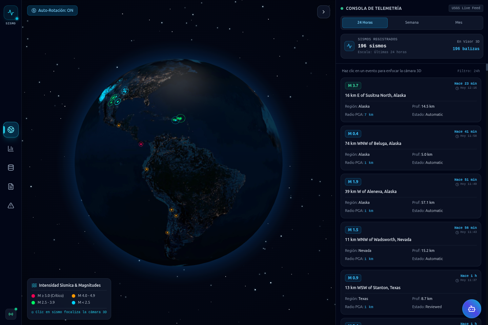
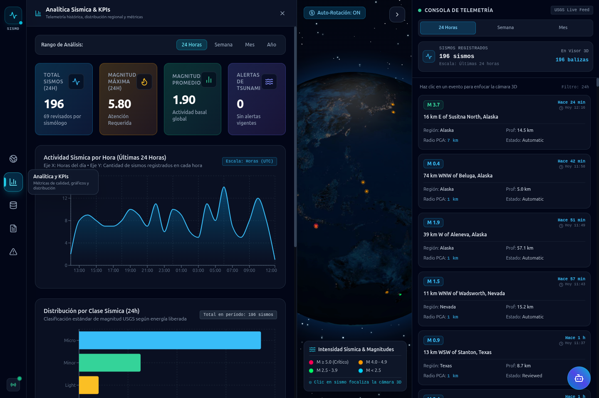
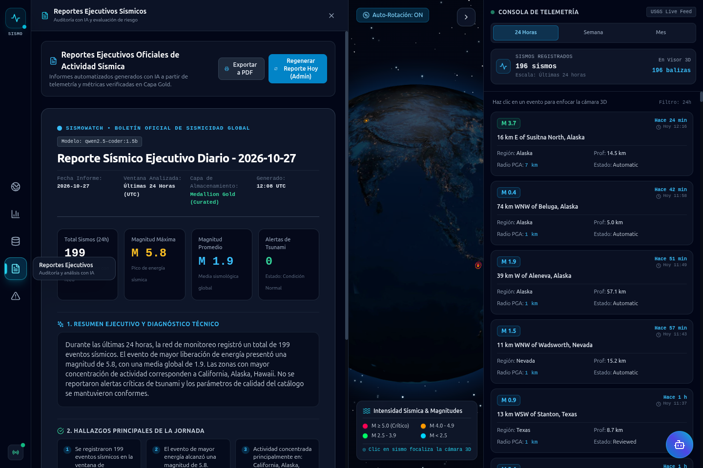
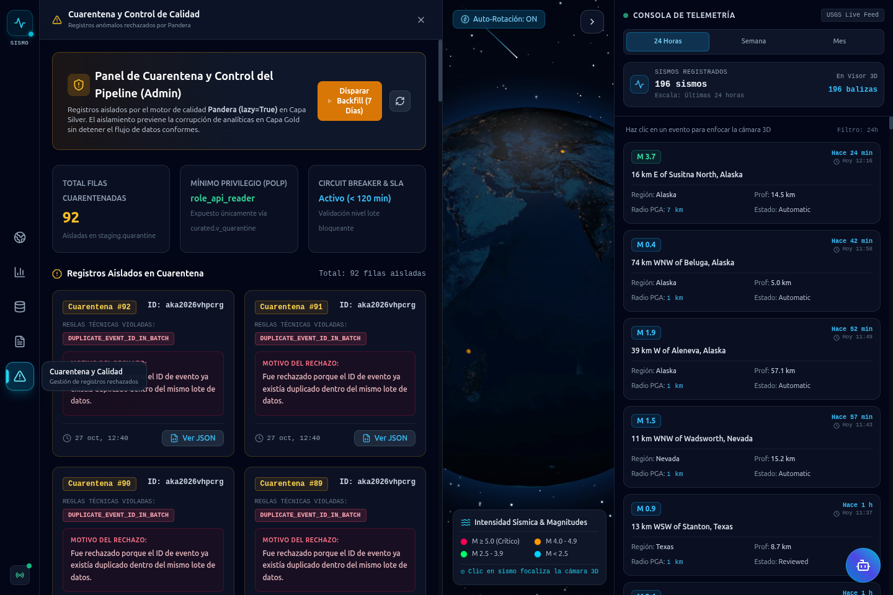
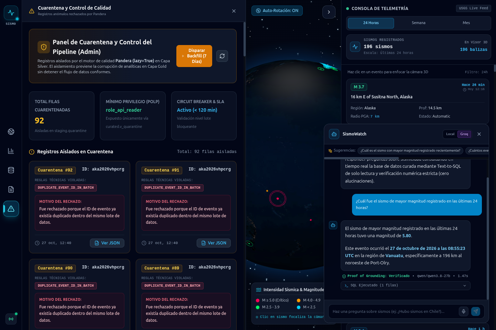
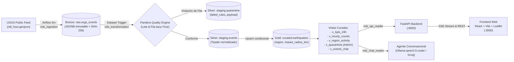

# SismoWatch - Plataforma de Monitoreo Sísmico Global y Plataforma Medallion E2E

[](https://airflow.apache.org/)
[](https://www.postgresql.org/)
[](https://min.io/)
[](https://fastapi.tiangolo.com/)
[](https://react.dev/)
[](https://ollama.ai/)
[](https://pandera.readthedocs.io/)
[](https://github.com/gitleaks/gitleaks)
[]()

**SismoWatch** es una plataforma de grado empresarial para la ingestión, auditoría de calidad, transformación analítica, enriquecimiento geofísico y explotación conversacional con IA de datos sísmicos mundiales en tiempo casi real desde el catálogo público de la **USGS (United States Geological Survey)**.

---

## 📸 Recorrido Visual de la Plataforma

| Cockpit 3D Globe & Centro de Telemetría | Dashboard Analítico y Distribución Temporal |
| :---: | :---: |
|  |  |
| *Globo 3D WebGL con balizas láser, estrellas cósmicas y telemetría dinámica (24h: 199 sismos, 7d: 1,536 sismos, 30d: 2,462 sismos).* | *Evolución acumulada mensual YTD (2026), distribución por magnitud Richter y regiones activas.* |

| Boletín Oficial de Sismicidad Global (Reportes IA) | Panel de Cuarentena y Calidad (Admin) |
| :---: | :---: |
|  |  |
| *Resumen ejecutivo estructurado en formato documento oficial, validación anti-alucinaciones y exportación.* | *Visualización de registros rechazados en 2 columnas, diagnóstico en lenguaje natural y backfill reactivo.* |

| Asistente Conversacional Grounded (Proof of Grounding) |
| :---: |
|  |
| *Traducción Text-to-SQL segura sobre `curated.v_events_chat`, síntesis con formato limpio y control por voz.* |

---

---

## 🎯 Elementos Diferenciadores del Proyecto

A diferencia de un dashboard convencional, SismoWatch implementa 3 elementos de ingeniería avanzada:

1. **Radio de Afectación Superficial Físico (PGA - Peak Ground Acceleration):**  
   Cálculo físico determinista del radio de afectación en kilómetros (`curated.earthquakes.impact_radius_km`) derivado de la magnitud y profundidad ($R = 10^{0.43 \cdot M - 0.005 \cdot h}$), graficado como círculos concéntricos dinámicos en el mapa Leaflet.
2. **Asistente Conversacional Grounded (Proof of Grounding):**  
   Cero alucinaciones numéricas. El agente traduce lenguaje natural a SQL de solo lectura sobre la vista restringida `curated.v_events_chat`, validado por un guardrail AST/regex y ejecutado bajo `role_chat_reader` (`read_only = on`, `timeout = 3000ms`). La UI expone la consulta SQL y la insignia de **Proof of Grounding** verificada.
3. **SLA de Frescura y Circuit Breaker de Calidad:**  
   Validación en dos niveles con Pandera. Nivel lote bloqueante (circuit breaker si la latencia del feed excede 120 min o hay volumen anómalo) y nivel fila (`lazy=True`) que enruta eventos corruptos a `staging.quarantine` sin detener los datos válidos.

---

## 🏛️ Arquitectura Medallion y Gobernanza de Datos



### Mapeo de Capas Medallion
* **Bronze (`raw.usgs_events`):** Ingesta cruda inmutable (`JSONB` + hash SHA-256 determinista) con política append-only (`ON CONFLICT DO NOTHING`).
* **Silver (`staging`):** Tipado estricto y separación de calidad. Registros conformes a `staging.events`; registros corruptos aislados en `staging.quarantine` con catálogo de reglas fallidas y causa documentada.
* **Gold (`curated`):** Estado actual consolidado (`curated.earthquakes`) con upsert condicional (`updated_time`), derivación de `region`, `magnitude_class` y `impact_radius_km`. Vistas optimizadas sin sobreingeniería (vistas normales de PostgreSQL).

---

## 🛡️ Matriz de Mínimo Privilegio (POLP en PostgreSQL)

| Rol de Base de Datos | Usuario | Permisos Permitidos | Lo que tiene PROHIBIDO |
| :--- | :--- | :--- | :--- |
| **`role_ingestion`** | `user_ingestion` | `INSERT, SELECT` sobre `raw.usgs_events` | Cero acceso a esquemas `staging` y `curated`. |
| **`role_transformation`** | `user_transformation` | `SELECT` en `raw`; `SELECT, INSERT, UPDATE, DELETE` en `staging` y `curated`. | Modificar DDL de esquemas o acceder a catálogos de sistema. |
| **`role_api_reader`** | `user_api_reader` | `SELECT` sobre tablas y vistas de `curated`. | Cero acceso a `raw` y `staging`; prohibida toda escritura (`INSERT, UPDATE, DELETE`). |
| **`role_chat_reader`** | `user_chat_reader` | `SELECT` **exclusivamente** sobre `curated.v_events_chat`. | `default_transaction_read_only = on`, `statement_timeout = 3000ms`. Prohibido cualquier acceso a tablas base u otros esquemas. |
| **`role_api_logger`** | `user_api_logger` | `INSERT` en `curated.ai_runs` y `SELECT (run_id)`. | Cero lectura sobre eventos o cuarentena. |

---

## 🤖 Benchmark de Modelos Locales (Evaluación con Evidencia)

Banco de pruebas ejecutado con 8 consultas Text-to-SQL, 1 reporte ejecutivo y 2 explicaciones de anomalías:

| Modelo | Parámetros / Peso | Precisión SQL | Precisión Numérica (Español) | Latencia Media | Tokens/seg | Decisión Técnica |
| :--- | :--- | :--- | :--- | :--- | :--- | :--- |
| **`qwen2.5-coder:1.5b`** | **1.5B (986 MB)** | **100% (8/8)** | **100% (Sin alucinaciones)** | **2.32 s** | **13.5** | **SELECCIONADO (Óptimo CPU/RAM)** |
| `phi3:latest` | 3.8B (2.2 GB) | 87.5% (7/8) | 100% | 5.34 s | 8.8 | Descartado (2.3x más lento) |
| `llama3.2:3b` | 3.2B (2.0 GB) | 100% (8/8) | 60% (Inventó cifras) | 4.88 s | 10.2 | Descartado (Alucinación numérica) |

*El sistema también incluye soporte para proveedor cloud opcional vía **Groq** (`llama-3.1-8b-instant`) mediante variable `GROQ_API_KEY`.*

---

## 🚀 Despliegue en Un Solo Comando

### Requisitos
* Docker Engine 24+ y Docker Compose v2+
* Python 3.11+
* Ollama corriendo en el host (`localhost:11434`) con el modelo `qwen2.5-coder:1.5b` (`ollama run qwen2.5-coder:1.5b`)

### 1. Iniciar Todo el Ecosistema
```bash
docker compose up -d
```

### 2. Accesos Rápidos y Credenciales de Evaluación

| Servicio | URL | Rol / Credenciales | Descripción |
| :--- | :--- | :--- | :--- |
| **Plataforma Web (React)** | http://localhost:3000 | `viewer` / `viewer_sismowatch_2026_pwd`<br>`admin` / `admin_sismowatch_2026_pwd` | Dashboard, Mapa PGA, Recharts, Catálogo CSV, Chat IA y Panel de Cuarentena. |
| **API REST (FastAPI / Swagger)** | http://localhost:8000/docs | Autenticación Bearer JWT (`/auth/login`) | Endpoints Medallion, SSE Streaming (`/api/stream`) y Chat Grounded. |
| **Apache Airflow 2.10** | http://localhost:8080 | `sismo_admin` / `sismo_admin_secure_pwd_2026` | Orquestador LocalExecutor con 4 DAGs activos y Datasets reactivos. |
| **MinIO Object Storage (Console)** | http://localhost:9001 | `sismowatch_minio_admin` / `minio_sismowatch_2026_pwd` | Consola Web Data Lakehouse para explorar Parquets Medallion (`sismowatch-lake`). |
| **MinIO S3 API** | http://localhost:9000 | Credenciales S3 v4 | Endpoint de almacenamiento de objetos compatible con AWS S3. |
| **PostgreSQL 16** | `localhost:5432` | Base de datos `sismowatch_db` | Schemas `raw`, `staging` y `curated` con POLP. |

> **Tip de Evaluación:** El modal de inicio de sesión en el navegador cuenta con botones de **Acceso Rápido** (`[ Rol Viewer ]` y `[ Rol Admin ]`) para ingresar con un solo clic.

---

## 🧪 Verificación y Pruebas Automatizadas

El proyecto cuenta con **40 pruebas unitarias y de integración** pasando al 100%:

```bash
PYTHONPATH=airflow:api .venv/bin/pytest tests/ -vv
```

### Cobertura de Tests:
* `tests/test_roles_permissions.py` (13 tests): Valida permisos positivos y negativos de cada rol (`role_ingestion`, `role_transformation`, `role_api_reader`, `role_chat_reader`, `role_api_logger`).
* `tests/test_minio_parquet.py` (5 tests): Valida particionamiento Medallion en Parquet, compresión Snappy, deduplicación de eventos y resiliencia no bloqueante ante fallos de conexión.
* `tests/test_quality.py` (5 tests): Valida circuit breaker a nivel lote (esquema, volumen, frescura), aislamiento a nivel fila en cuarentena con Pandera `lazy=True` y serialización datetime en payloads JSONB.
* `tests/test_transform.py` (5 tests): Valida extracción de región, clasificación de magnitud, radio de impacto PGA y hashing SHA-256.
* `tests/test_dags_integrity.py` (2 tests): Valida sintaxis AST e importación limpia en DagBag dentro del contenedor Airflow (4 DAGs sin errores).
* `tests/test_api_rbac.py` (10 tests): Valida endpoints de FastAPI, tokens JWT, restricción 403 a cuarentena para `viewer`, acceso 200 para `admin`, descarga CSV y guardrail SQL.

---

## 🔒 Auditoría de Seguridad y Cero Secretos

* **Gitleaks (Detección de Secretos):** 12 commits escaneados con `0 fugas detectadas`.
* **Bandit (SAST Python):** Escaneo de código en `api/` y `airflow/include/` con `0 vulnerabilidades`.
* Reporte oficial disponible en [docs/security_audit.txt](docs/security_audit.txt).

---

## 🗣️ Guía de Sustentación Oral (Cómo Defender el Proyecto)

Para la sustentación ante el Tech Lead o evaluador, utiliza estos argumentos técnicos clave:

1. **¿Por qué Medallion y no Lambda?**  
   *La arquitectura Lambda introduce doble pipeline (Batch y Speed) con duplicación de código y sincronización compleja. Con miles de eventos por hora y latencia requerida de 5 minutos, la arquitectura Medallion sobre PostgreSQL 16 con Datasets reactivos de Airflow cubre completamente la frescura sin sobreingeniería.*
2. **¿Cómo garantizas que el agente conversacional no invente cifras?**  
   *Principio de Proof of Grounding: El LLM nunca genera números de su memoria. Su única tarea es traducir la pregunta a una sentencia `SELECT` sobre `curated.v_events_chat`. La consulta pasa por un guardrail AST/regex que bloquea DDL/DML, se ejecuta bajo `role_chat_reader` (solo lectura dura y timeout de 3s en PostgreSQL), y la respuesta final se sintetiza exclusivamente a partir de las filas devueltas.*
3. **¿Cómo se manejaron los registros con errores de calidad?**  
   *Validación en dos niveles con Pandera: a nivel lote se verifica la frescura (< 120 min) y estructura del GeoJSON (circuit breaker bloqueante). A nivel fila, usando `lazy=True`, los registros que violan rangos de coordenadas o fechas futuras se desvían a `staging.quarantine` con sus reglas fallidas documentadas, permitiendo que los datos conformes continúen hacia Gold sin interrupción.*
4. **¿Por qué la arquitectura híbrida con MinIO y Parquet (Hot/Cold Tiering)?**  
   *Separación de responsabilidades: PostgreSQL opera como Hot Tier para baja latencia (FastAPI, Leaflet, SSE `/api/stream`, Text-to-SQL). MinIO opera como Cold Tier (Data Lakehouse) almacenando el histórico inmutable en Apache Parquet con compresión Snappy particionado por fecha (`bronze/year=...`, `silver/valid/...`, `silver/quarantine/...`, `gold/...`). La exportación es resiliente y no bloqueante: si MinIO sufriera una caída temporal, el pipeline en PostgreSQL continúa sin interrupciones.*

---

## 📁 Estructura del Repositorio

```text
├── airflow/
│   ├── dags/
│   │   ├── usgs_ingest_feed.py           # Ingesta Bronze cada 5 min & export Parquet
│   │   ├── usgs_transform_quality.py     # Silver & Gold reactivo & export Parquet
│   │   ├── usgs_historical_backfill.py   # Backfill bajo demanda (Admin)
│   │   └── usgs_daily_report_anomaly.py  # Reporte diario y Z-score (06:00 UTC)
│   ├── include/
│   │   ├── db.py                         # Conexiones e inserciones idempotentes
│   │   ├── minio_exporter.py             # Exportador Parquet Snappy Medallion a MinIO
│   │   ├── transform.py                  # Normalización, PGA impact radius
│   │   ├── quality.py                    # Reglas Pandera en dos niveles
│   │   ├── callbacks.py                  # Webhooks de alerta
│   │   └── openmetadata_emitter.py       # Emisor de linaje JSON
│   ├── Dockerfile
│   └── requirements.txt
├── api/
│   ├── routers/                          # Endpoints modulares (auth, kpis, events, chat, stream...)
│   ├── services/ai_service.py            # Text-to-SQL, Guardrails y Grounding
│   ├── auth.py                           # Stateless JWT RBAC (admin / viewer)
│   ├── config.py                         # Pydantic Settings
│   ├── db.py                             # Conexiones POLP (reader, chat, logger)
│   ├── Dockerfile
│   └── main.py
├── web/
│   ├── src/components/                   # UI React (Map PGA, Charts, Chat, Quarantine)
│   ├── nginx.conf                        # Reverse proxy + SSE no buffering
│   ├── Dockerfile
│   └── package.json
├── db/init/
│   ├── 01_schemas_and_roles.sql          # POLP y restricciones de sesión
│   └── 02_tables_and_views.sql           # Tablas Medallion y Vistas Gold
├── docs/
│   ├── ARQUITECTURA.md                   # Especificación técnica Medallion
│   ├── OPENMETADATA.md                   # Linaje y gobernanza
│   └── security_audit.txt                # Reporte Bandit & Gitleaks
├── tests/                                # 40 pruebas unitarias y de integración
├── docker-compose.yml                    # Orquestación de todo el stack
├── PLAN.md                               # Plan de ejecución y matriz de trazabilidad
└── README.md
```

---

## ⚖️ Limitaciones Conocidas y Mejoras Futuras

### Limitaciones Actuales
1. **Frecuencia de Fuente Pública:** La USGS actualiza su feed de última hora (`all_hour.geojson`) cada ~1 minuto. Consultas con frecuencia sub-segundo no aportan nuevos datos y saturarían la API pública.
2. **Backfill Histórico sin Filtros de Micro-sismos:** Para consultas de más de 30 días, la USGS limita la respuesta a eventos de magnitud $\ge 2.5$ para prevenir payloads superiores a 50 MB en una sola llamada HTTP.
3. **Dependencia de Hardware Local para LLM:** En entornos con CPU compartida sin aceleración por GPU, el motor local de Ollama puede presentar latencias de entre 5 y 15 segundos para síntesis de reportes complejos (mitigado con fallback a Groq en Modo Cloud).

### Mejoras Futuras Planificadas (Evolución a Producción)
1. **Lakehouse con DuckDB / Trino:** Habilitar consultas federadas directas sobre las particiones Parquet en MinIO (`s3://sismowatch-lake/bronze/` y `gold/`) sin pasar por PostgreSQL.
2. **Vector Database (pgvector / Qdrant):** Indexación de resúmenes históricos para búsqueda semántica de eventos análogos (ej: "buscar terremotos con mecanismo focal similar al de Japón 2011").
3. **Alertas Push Automatizadas:** Integración de webhooks para canales de Telegram y Slack ante activación de alerta de tsunami (`tsunami_alert = true`).
