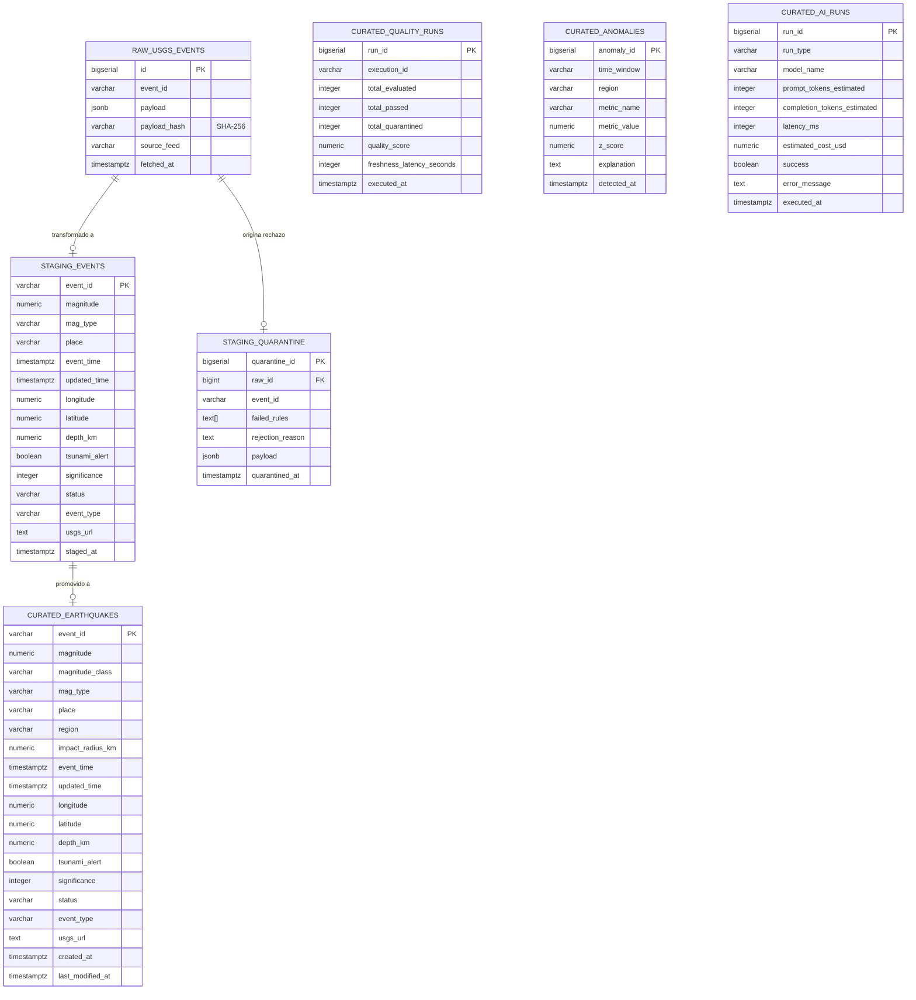

# SismoWatch - Documento de Arquitectura de Datos y Plataforma

## 1. Propósito de la Arquitectura
La arquitectura de **SismoWatch** resuelve la necesidad crítica de transformar un feed público, efímero y no validado de eventos sísmicos globales (USGS Earthquake Catalog) en un **producto de datos empresarial confiable, seguro, auditable y de alto valor analítico**.

### ¿Para quién y qué decisiones habilita?
* **Equipos de Monitoreo y Operaciones:** Detección en tiempo casi real de sismos de magnitud crítica con potencial de tsunami para activación de protocolos de contingencia y asignación de recursos.
* **Equipos de Gestión del Riesgo y Geociencias:** Análisis de patrones espacio-temporales, distribución de magnitudes por Ley de Gutenberg-Richter, radios teóricos de percepción y enjambres sísmicos para actualización de modelos de vulnerabilidad territorial.
* **Liderazgo Técnico y Oficiales de Auditoría/Seguridad:** Garantía de trazabilidad completa desde el dato crudo (Bronze) hasta el consumo analítico y conversacional con IA (Gold), garantizando cero alucinaciones y estricto principio de mínimo privilegio (POLP).

---

## 2. Recorrido Visual de la Plataforma Implementada

| Cockpit 3D Globe & Consola de Telemetría | Dashboard Analítico y Distribución Temporal |
| :---: | :---: |
|  |  |
| *Globo 3D WebGL con balizas láser, estrellas cósmicas y telemetría dinámica.* | *Evolución acumulada mensual YTD (2026), distribución por magnitud Richter y regiones activas.* |

| Boletín Oficial de Sismicidad Global (Reportes IA) | Panel de Cuarentena y Calidad (Admin) |
| :---: | :---: |
|  |  |
| *Resumen ejecutivo estructurado en formato documento oficial, validación anti-alucinaciones.* | *Visualización de registros rechazados en 2 columnas, diagnóstico en lenguaje natural.* |

| Asistente Conversacional Grounded (Proof of Grounding) |
| :---: |
|  |
| *Traducción Text-to-SQL segura sobre `curated.v_events_chat`, síntesis limpia y reconocimiento por voz.* |

---

## 3. Diagrama de Arquitectura End-to-End (Medallion Lakehouse)

```mermaid
flowchart TD
    USGS["USGS Public Feed API\n(/all_hour.geojson)"] -->|Airflow DAG: usgs_ingest_feed\nrole_ingestion (Cada 5 min)| Bronze[("CAPA 1: BRONZE\nPostgreSQL: raw.usgs_events\nJSONB inmutable + SHA-256")]
    Bronze -->|Export Parquet Snappy| MinIOBronze[("MinIO Cold Tier\ns3://sismowatch-lake/bronze/")]
    
    Bronze -.->|Dataset Trigger: raw_events_dataset| DagTransform["Airflow DAG: usgs_transform_quality\nrole_transformation"]
    
    subgraph QualityEngine ["Motor de Calidad Pandera (Circuit Breaker & Quarantine)"]
        BatchCheck{"Validación Lote\n(Esquema, Volumen, Frescura <120m)"}
        RowCheck{"Validación Fila (lazy=True)\n(Coords, Fechas, Magnitud [-1, 10])"}
    end
    
    DagTransform --> BatchCheck
    BatchCheck -->|Lote Corrupto| CircuitBreak["Fallo de Tarea y Alerta\n(Cero propagación a Silver/Gold)"]
    BatchCheck -->|Lote Conforme| RowCheck
    
    RowCheck -->|Fila Rechazada| StgQuarantine[("CAPA 2: SILVER (Cuarentena)\nPostgreSQL: staging.quarantine\n(failed_rules, payload JSONB)")]
    RowCheck -->|Fila Conforme| StgEvents[("CAPA 2: SILVER (Limpio)\nPostgreSQL: staging.events\n(Tipado normalizado)")]
    
    StgQuarantine --> MinIOQuarantine[("MinIO Cold Tier\nsilver/quarantine/")]
    StgEvents --> MinIOSilver[("MinIO Cold Tier\nsilver/valid/")]
    
    StgEvents -->|Upsert condicional: updated_time\nCálculo Radio PGA + Región| Gold[("CAPA 3: GOLD (Curated)\nPostgreSQL: curated.earthquakes\n(region, impact_radius_km)")]
    Gold --> MinIOGold[("MinIO Cold Tier\ngold/earthquakes_curated.parquet")]
    
    subgraph Consumo ["Capa de Consumo y Servicios"]
        Vistas["Vistas Especializadas:\n- v_kpis_24h\n- v_hourly_counts\n- v_region_activity\n- v_magnitude_distribution\n- v_events_chat"]
        API["FastAPI REST & SSE Stream\n(:8000 / role_api_reader)"]
        ChatAgent["Asistente IA Grounded\n(Ollama / Groq / role_chat_reader)"]
        Frontend["React 18 + Vite + Leaflet + 3D Globe\n(:3000)"]
    end
    
    Gold --> Vistas
    Vistas --> API
    Vistas --> ChatAgent
    API --> Frontend
    ChatAgent --> Frontend
```

---

## 4. Modelo de Datos Relacional (Diagrama Entidad-Relación)



---

## 5. Matriz de Seguridad y Mínimo Privilegio (POLP en PostgreSQL)

El sistema garantiza que ninguna credencial única tenga acceso ilimitado a la base de datos:

| Rol de Base de Datos | Usuario | Permisos Otorgados | Restricciones Duras y Prohibiciones |
| :--- | :--- | :--- | :--- |
| **`role_ingestion`** | `user_ingestion` | `INSERT, SELECT` sobre `raw.usgs_events` | Prohibido cualquier acceso a `staging` y `curated`. |
| **`role_transformation`** | `user_transformation` | `SELECT` en `raw`; `SELECT, INSERT, UPDATE, DELETE` en `staging` y `curated`. | Prohibido DDL (modificación de esquemas) o acceso a catálogos de sistema. |
| **`role_api_reader`** | `user_api_reader` | `SELECT` sobre tablas y vistas de `curated`. | Prohibido todo acceso a `raw` y `staging`; prohibida toda escritura (`INSERT, UPDATE, DELETE`). |
| **`role_chat_reader`** | `user_chat_reader` | `SELECT` **única y exclusivamente** sobre `curated.v_events_chat`. | `default_transaction_read_only = on`, `statement_timeout = 3000ms`. Prohibido acceso a tablas base u otros schemas. |
| **`role_api_logger`** | `user_api_logger` | `INSERT` en `curated.ai_runs` y `SELECT (run_id)`. | Cero permisos de lectura sobre eventos sísmicos o registros en cuarentena. |

---

## 6. Trade-offs de Arquitectura y Decisiones Defendibles

| Decisión Técnica | Alternativa Evaluada | Razón de la Elección y Justificación | Trade-off Asumido |
| :--- | :--- | :--- | :--- |
| **Medallion Lakehouse Híbrido (PostgreSQL 16 + MinIO Parquet)** | Arquitectura Lambda tradicional o PostgreSQL monolítico | Combina la baja latencia de PostgreSQL (Hot Tier para UI y SSE) con la escalabilidad y compatibilidad columnar inmutable de Parquet en MinIO (Cold Tier). | Ligero incremento en lógica de exportación dual en Airflow; mitigado mediante desacoplamiento no bloqueante. |
| **Airflow Datasets (Data-Aware Scheduling)** | Consultas periódicas tipo cron en cada DAG | El DAG de transformación reacciona al instante exacto en que la ingesta finaliza con éxito (`Dataset("sismowatch://raw/usgs_events")`), eliminando esperas pasivas y sobrecarga innecesaria. | Requiere que ambos DAGs compartan el mismo URI semántico de Dataset. |
| **Validación en Dos Niveles con Pandera (`lazy=True`)** | Pydantic fila por fila o Great Expectations | Pandera ejecuta validaciones vectorizadas de alto rendimiento sobre DataFrames. A nivel lote valida frescura y volumen (circuit breaker bloqueante); a nivel fila desvía los registros inválidos a `staging.quarantine` sin detener los datos limpios. | Mayor consumo de memoria temporal durante la validación del lote. |
| **Proof of Grounding (Text-to-SQL + AST Guardrail)** | RAG Vectorial con Embeddings de texto | Los datos sísmicos son numéricos y tabulares. Los embeddings pierden precisión al realizar agregaciones numéricas exactas (ej. MAX, AVG, COUNT). Text-to-SQL sobre una vista restringida con timeout de 3s garantiza 100% de fidelidad numérica. | El modelo requiere comprender la estructura de la consulta SQL (mitigado con `qwen2.5-coder:1.5b` o Groq). |
| **Server-Sent Events (SSE) con `EventSource` y JWT Token** | WebSockets bidireccionales o Polling HTTP | El monitoreo sísmico requiere flujo unidireccional servidor $\rightarrow$ cliente en tiempo real. SSE opera sobre HTTP estándar, atraviesa proxies y reconecta automáticamente. La autenticación se verifica con JWT en query parameter (`/api/stream?token=...`) retornando HTTP 401 si es inválido o no existe. | No admite comunicación bidireccional en el mismo socket (el chat utiliza endpoints POST independientes). |

---

## 7. Evolución a Producción y Criterios de Escala

| Componente Futuro | Criterio de Activación (Threshold) | Beneficio y Justificación Técnica |
| :--- | :--- | :--- |
| **Apache Spark / Flink** | Ingesta masiva $> 100\text{ GB/día}$ o redes sísmicas de alta frecuencia ($> 5,000\text{ lecturas/s}$). | Procesamiento en streaming distribuido y ventanas de tumbling para calcular correlaciones de aceleración sin saturar la CPU de PostgreSQL. |
| **Motor de Consulta Federada (DuckDB / Trino)** | Equipos analíticos que requieran consultar el Cold Tier directamente. | Ejecución de SQL analítico directo sobre los Parquets particionados en MinIO (`s3://sismowatch-lake/gold/`) con latencia de segundos y coste cero en base de datos transaccional. |
| **Gobernanza Empresarial (OpenMetadata)** | Despliegue en organizaciones con múltiples equipos y requerimientos de compliance. | Trazabilidad automatizada de linaje columna por columna, catálogo de términos de negocio y auditoría de accesos sensibles. |
| **Vector DB (pgvector / Qdrant)** | Búsqueda de eventos análogos por mecanismo focal. | Comparación semántica de tensores de momento sísmico y espectros de respuesta frente a terremotos históricos. |
