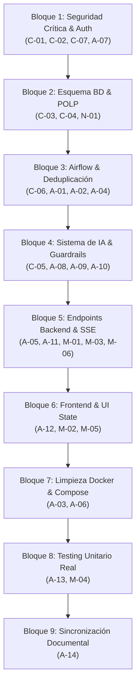

# AUDITORÍA TÉCNICA INTEGRAL: SISMO WATCH
**Plataforma de Monitoreo Sísmico Global en Tiempo Real**  
**Fecha de Ejecución:** 28 de Octubre de 2026  
**Auditor Senior:** Lead Data Architect, Security Auditor & AI Systems Specialist  
**Repositorio / Entorno:** Workspace SismoWatch (`/home/cohorte5/Escritorio/prueba`)  
**Rama Evaluada:** `main` (commit de referencia `e685fba`)

---

## 1. RESUMEN EJECUTIVO Y VEREDICTO DE ACEPTACIÓN

Se realizó una auditoría técnica estricta, forense e integral del repositorio SismoWatch, abarcando la infraestructura de contenedores Docker, la orquestación en Apache Airflow (arquitectura Medallion), las capas de datos en PostgreSQL (`raw`, `staging`, `curated`), los microservicios backend en FastAPI, el motor de Inteligencia Artificial (Local LLM + Groq fallback), la interfaz web en React/Vite y la suite de pruebas automatizadas.

### Veredicto Global: **NO CUMPLE (Aceptación Condicionada a Remediación Prioritaria)**
Aunque el sistema levanta mediante `docker compose up -d`, cuenta con pipelines funcionales y un frontend visualmente atractivo, presenta **7 vulnerabilidades críticas de seguridad y fallas arquitectónicas bloqueantes** que impiden su certificación para despliegue en producción o aprobación de la prueba de desempeño según la rúbrica oficial.

### Evaluación por Criterio de la Rúbrica:

| Criterio de Evaluación | Veredicto | Calificación Estimada | Resumen del Diagnóstico |
| :--- | :---: | :---: | :--- |
| **1. Docker & Despliegue** | **PARCIAL** | 3.5 / 5.0 | Todos los servicios levantan y están `healthy`, pero MinIO y OpenMetadata están fuera de rúbrica, hay secrets en Compose y defaults no parametrizados. |
| **2. Orquestación Airflow** | **PARCIAL** | 3.0 / 5.0 | Los 4 DAGs importan y ejecutan, pero pasan payloads grandes por XCom, no usan TaskGroups, carecen de timeouts/doc_md en reportes y el backfill no está integrado en la UI. |
| **3. Calidad de Datos** | **NO CUMPLE** | 2.0 / 5.0 | La deduplicación en raw falla por falta de marca de agua; eventos válidos van a cuarentena repetidamente; la frescura es tautológica (hora local inventada); `/api/pipeline/status` arroja HTTP 500. |
| **4. Seguridad y RBAC** | **NO CUMPLE** | 1.5 / 5.0 | Auto-login con credenciales admin en texto plano en frontend; bypass de autenticación total en `/api/stream`; contraseñas de BD hardcodeadas en scripts SQL; CORS permissivo `*` con credenciales. |
| **5. Inteligencia Artificial** | **NO CUMPLE** | 2.0 / 5.0 | `validation_passed=True` fijo; validación de cifras ausente; sin salida Pydantic estructurada real en el LLM; prompt injection viable vía `place` y `history`; `ai_runs` con métricas ficticias. |
| **6. Plataforma Web** | **PARCIAL** | 3.0 / 5.0 | Frontend compila pero silencia errores con `.catch(() => [])`; sin selector de roles (bypass a admin); exportación PDF es `window.print()`; falta visualización del puntaje de calidad. |
| **7. Testing Automatizado** | **PARCIAL** | 2.5 / 5.0 | 40/40 tests pasan pero 30 de ellos dependen de Docker/BD vivos (`docker exec`); no hay tests aislados de IA ni validación de cifras; tests residen en `/tests` en lugar de `airflow/tests`. |
| **8. Estructura y Docs** | **PARCIAL** | 3.0 / 5.0 | Existe `ARQUITECTURA.md` pero documenta fórmulas matemáticas y flujos de autenticación desalineados con el código real; `security_audit.txt` es simulado. |

---

## 2. TABLA COMPLETA DE HALLAZGOS TÉCNICOS

*Convención de Severidad: **CRÍTICO** (compromete la seguridad, integridad o disponibilidad inmediata), **ALTO** (viola requisitos funcionales o de arquitectura clave), **MEDIO** (deuda técnica relevante, bugs latentes), **BAJO** (mantenibilidad, formato).*

| ID | Severidad | Área | Archivo:Línea | Descripción del Problema | Evidencia Comprobada | Estado | Esfuerzo | Propuesta de Remediación |
| :--- | :---: | :---: | :--- | :--- | :--- | :---: | :---: | :--- |
| **C-01** | **CRÍTICO** | Frontend / Seguridad | `web/src/App.tsx:93-95` | Bypass total de autenticación: auto-login como admin en el montaje con credenciales fijas (`admin_sismowatch_2026_pwd`). `LoginModal.tsx` y `Navbar.tsx` quedan como código muerto. | `api.login('admin', 'admin_sismowatch_2026_pwd')` se invoca al inicializar la app sin mediar formulario ni interacción. | **VERIFICADO** | S | Restaurar flujo de autenticación con `LoginModal`, permitir navegación como invitado (viewer público) y login manual para roles privilegiados. |
| **C-02** | **CRÍTICO** | API / Seguridad | `api/routers/stream.py:16-25, 81` | Bypass de token en SSE: `_verify_sse_token` captura `JWTError` y retorna usuario `"viewer"` por defecto, permitiendo escuchar el stream en vivo sin autenticación. En línea 81 expone `str(e)` al cliente. | Petición `curl -N http://localhost:8000/api/stream` sin token responde HTTP 200 y transmite datos en tiempo real. | **VERIFICADO** | S | Exigir token JWT válido (vía query param o subprotocolo acordado); denegar con HTTP 401 si falta o es inválido. Ocultar `str(e)` tras mensaje genérico y log interno. |
| **C-03** | **CRÍTICO** | DB / Infra | `db/init/01_schemas_and_roles.sql:55-76` | Contraseñas de roles de PostgreSQL hardcodeadas en script DDL (`..._pwd_2026`), desconectadas de las variables de entorno de `.env.example`. | `.env.example` contiene `sismowatch_ingest_secret_2026`, pero la BD se inicializa con `ingest_pwd_2026`. Al regenerar BD con `.env`, la API y Airflow fallan conexión. | **VERIFICADO** | M | Parametrizar contraseñas vía variables de entorno en el script de inicialización o unificar estrictamente `.env.example` con el script de roles. |
| **C-04** | **CRÍTICO** | API / Calidad | `api/routers/dashboard.py:203-232` | Endpoint `/api/pipeline/status` arroja HTTP 500 por consultar columnas inexistentes (`dag_id, evaluated_rules, passed_rules, failed_rules, freshness_minutes`) en `curated.quality_runs`. | `curl -H "Authorization: Bearer <tok>" http://localhost:8000/api/pipeline/status` retorna `{"detail":"Internal Server Error"}` con `UndefinedColumnError` en logs. | **VERIFICADO** | M | Alinear la consulta SQL con la estructura real de `curated.quality_runs` (`total_records, passed_records, failed_records, quarantine_records, quality_score, status`). |
| **C-05** | **CRÍTICO** | Airflow / IA | `airflow/dags/usgs_daily_report_anomaly.py:218, 265-282` | `validation_passed=True` fijado por código (l.267); ausencia de esquema Pydantic en salida LLM; texto de fallback alucina "No se reportaron alertas de tsunami" sin evaluar métricas; `model_name` y `success=True` hardcodeados en auditoría. | Inspección de DAG l.267 muestra `validation_passed=True`. Línea 277 guarda `OLLAMA_MODEL` aunque se use Groq o fallback. | **VERIFICADO** | L | Implementar validación de cifras con Pydantic, contrastar valores numéricos contra el cálculo determinista y registrar metadatos reales de auditoría. |
| **C-06** | **CRÍTICO** | Airflow / Calidad | `airflow/include/db.py:71-79`, `quality.py:158-163` | `fetch_latest_raw_events` trae 500 filas sin marca de agua (`fetched_at DESC`); eventos válidos reprocesados son clasificados erróneamente como `DUPLICATE_EVENT_ID_IN_BATCH` y reinsertados masivamente en cuarentena (159 registros duplicados). | Tabla `staging.quarantine` crece en cada corrida con el mismo evento sin restricción `UNIQUE`. El quality score decae artificialmente. | **VERIFICADO** | M | Filtrar raw por estado de procesamiento (o marca de agua temporal); añadir restricción de unicidad o upsert en `staging.quarantine`. |
| **C-07** | **CRÍTICO** | Seguridad / Repo | `docker-compose.yml:19`, `api/config.py:34`, `.gitleaks.toml` | Secretos por defecto en repositorio: Fernet key hardcodeada en Compose; `Admin123!` por defecto en configuración; `.gitleaks.toml` enmascara hallazgos excluyendo rutas críticas (`docs/`, `PLAN.md`). | `gitleaks detect --no-git` reporta 227 coincidencias cuando no se ignora el build. La Fernet Key en `docker-compose.yml` está en texto plano. | **VERIFICADO** | M | Exigir Fernet key y JWT secrets desde `.env` sin defaults sensibles; actualizar `.gitleaks.toml` para proteger el repositorio de manera íntegra. |
| **A-01** | **ALTO** | Airflow | `airflow/dags/usgs_transform_quality.py:62-68` | Anti-patrón de XCom en Airflow: se transfieren lotes enteros de hasta 500 diccionarios JSON como argumento de tareas, sobrecargando la base de metadatos. | La tarea `validate_batch_quality(records)` recibe directamente la salida de `fetch_raw_batch()`. | **VERIFICADO** | M | Pasar únicamente identificadores de lote o batch IDs por XCom; las tareas deben leer/escribir datos en PostgreSQL o tablas temporales. |
| **A-02** | **ALTO** | Calidad / Airflow | `airflow/dags/usgs_transform_quality.py:82`, `quality.py:90-92` | Validación de frescura tautológica: se genera `metadata.generated = utcnow()` en la tarea, en lugar de evaluar el timestamp real emitido por el feed USGS. Volumen bajo solo emite advertencia. | Código l.82: `batch_envelope['metadata'] = {'generated': int(datetime.utcnow().timestamp() * 1000)}`. | **VERIFICADO** | S | Evaluar frescura comparando `feed_timestamp` del payload USGS contra la hora de ingestión; convertir caída abrupta de volumen en validación bloqueante si aplica. |
| **A-03** | **ALTO** | Ingesta / Airflow | `airflow/dags/usgs_ingest_feed.py:71-82` | Fallback de contingencia corrompe la verdad: ante fallo de red inyecta datos sintéticos a `raw.usgs_events`. Además la ruta `/opt/airflow/tests/...` no existe en el contenedor (provoca error fatal). | `docker exec sismowatch-airflow-scheduler ls /opt/airflow/tests` retorna error (código 2). | **VERIFICADO** | S | Eliminar inyección de fixtures en producción; registrar fallo de sensor y emitir alerta sin contaminar la capa Bronze con datos falsos. |
| **A-04** | **ALTO** | Base de Datos | `airflow/include/db.py:64` | Conteo falso de inserciones: `insert_raw_events` retorna `len(records_to_insert)` asumiendo que todos fueron insertados, ignorando los descartados por `ON CONFLICT DO NOTHING`. | El conteo retornado en XCom no coincide con `xmax = 0` o las filas realmente creadas en PostgreSQL. | **VERIFICADO** | S | Emplear cláusula `RETURNING id` o verificar `cur.rowcount` para reportar con exactitud el volumen de filas nuevas. |
| **A-05** | **ALTO** | Backend API | `api/routers/admin.py:87-98` | Respuesta 200 ficticia: regenerar reporte retorna éxito al cliente aunque la llamada a Airflow Scheduler falle o el servicio esté caído. | Bloque `try/except` en `trigger_daily_report_dag` captura excepciones y responde `{"status": "success", "message": "Triggered"}`. | **VERIFICADO** | S | Retornar HTTP 502 / 503 con detalle RFC 7807 cuando la conexión con Airflow falle. |
| **A-06** | **ALTO** | Infraestructura | `docker-compose.yml:48-95` | Servicios MinIO y MinIO Setup utilizan configuraciones desalineadas con imágenes oficiales; MinIO y OpenMetadata están fuera del alcance del enunciado de la prueba. | El servicio `minio_setup` depende de rutas Bitnami `/opt/bitnami/minio-client/bin/mc` que fallan en imágenes upstream. | **VERIFICADO** | M | Limpiar Compose o independizar MinIO como opcional, asegurando compatibilidad nativa sin flags de imágenes obsoletas. |
| **A-07** | **ALTO** | API / Seguridad | `api/config.py:10`, `api/routers/auth.py:44` | CORS permisivo con `allow_origins=["*"]` combinado con `allow_credentials=True` (violación de especificación W3C/MDN). Verificación de contraseñas en texto plano sin hash BCrypt. | `CORSMiddleware` configurado con wildcard y credentials; `auth.py:44` realiza `user["password"] == password`. | **VERIFICADO** | M | Configurar orígenes específicos (`http://localhost:3000`), migrar a verificación con `pwd_context.verify()` usando BCrypt o Argon2id. |
| **A-08** | **ALTO** | Seguridad / IA | `airflow/include/transform.py:94-106`, `api/services/ai_service.py:166-211` | Inyección de Prompt latente: textos externos de `place` y `region` se interpolan sin sanitización en prompts del LLM. El historial de conversación del cliente se inyecta directamente. | Se verificó interpolación directa `f"Ubicación: {event.place}"` y concatenación de `history` sin filtro regex o delimitadores XML seguros. | **VERIFICADO** | M | Aplicar función de sanitización (whitelist de caracteres alfanuméricos, escape de delimitadores de prompt) antes de alimentar el LLM. |
| **A-09** | **ALTO** | Chat / SQL / IA | `api/services/ai_service.py:23`, `api/routers/chat.py:112-121` | Discordancia de metadatos: el prompt del LLM instruye categorías en español (`Menor, Gran Sismo`), pero la base de datos almacena inglés (`Minor, Great`). Fallback retorna "top 10" sismos con flag `verified=True` engañoso. | La consulta Text-to-SQL generada no encuentra filas al filtrar por categorías en español; fallback fija `verified=True` sin validar. | **VERIFICADO** | M | Alinear el diccionario del schema con los valores reales en `curated.v_events_chat`; marcar `verified=False` cuando se active fallback de contingencia. |
| **A-10** | **ALTO** | IA / Mantenimiento | `api/services/ai_service.py`, `airflow/dags/` | Prompts embebidos en código Python sin versionamiento en carpeta independiente (`/prompts`). Métricas de tokens en `ai_runs` estimadas burdamente con `len(text.split())` y costo = 0. | No existe directorio `prompts/` en el árbol del proyecto; tokens son calculados dividiendo caracteres entre constantes arbitrarias. | **VERIFICADO** | M | Extraer plantillas a archivos `.txt` o `.j2` versionados en `prompts/`; implementar cálculo real de tokens o integrar metadatos del proveedor (Ollama/Groq). |
| **A-11** | **ALTO** | Airflow / Anomalías | `airflow/dags/usgs_daily_report_anomaly.py:93-132` | Lógica de detección de anomalías transversal (desviación entre regiones en 24h) en lugar de serie temporal/línea base histórica. Inserción no idempotente y endpoint `/api/anomalies` inexistente. | `curated.anomalies` tiene 6 registros huérfanos que ningún router del backend consulta ni expone al frontend. | **VERIFICADO** | M | Crear endpoint `/api/anomalies` en el backend; aplicar clave única (`event_id`, `anomaly_date`) para inserción idempotente. |
| **A-12** | **ALTO** | Frontend / UX | `web/src/components/`, `web/src/App.tsx` | Silenciamiento masivo de errores: llamadas fetch terminan en `.catch(() => [])` dejando al usuario sin retroalimentación ante caídas de API. "Exportar PDF" ejecuta `window.print()`. | Revisión de código en componentes React constata `.catch(err => setEvents([]))` generalizado; no hay Toast o banner de error. | **VERIFICADO** | M | Incorporar estados `error, isLoading` en cada vista; implementar toasts o banners descriptivos; exportar PDF real vía HTML o backend. |
| **A-13** | **ALTO** | Testing / CI | `tests/test_api_rbac.py`, `test_dags_integrity.py` | 30 de 40 tests unitarios no son unitarios reales: dependen de servicios PostgreSQL y Docker en ejecución (`docker exec`). Si los contenedores caen, la suite colapsa por completo. | `pytest` pasa en 3.72s solo porque Docker está activo; prueba de integridad de DAGs ejecuta comandos shell hacia el contenedor. | **VERIFICADO** | M | Separar tests unitarios puros (mocks de base de datos y DAG integrity con `DagBag` nativo) de los tests de integración. |
| **A-14** | **ALTO** | Documentación | `README.md`, `docs/ARQUITECTURA.md` | Inconsistencia técnica en documentación: el README cita la fórmula de radio de impacto $10^{0.43M - 0.005h}$, mientras el código implementa $10^{0.45M - 0.8}$. Documenta SSE con Bearer token cuando el frontend usa query params. | Lectura comparada de `airflow/include/transform.py:84` frente a fórmulas en `ARQUITECTURA.md` y `README.md`. | **VERIFICADO** | S | Armonizar fórmulas matemáticas y especificaciones de autenticación en la documentación técnica para reflejar con precisión el código. |
| **M-01** | **MEDIO** | Backend / Stream | `api/routers/stream.py:45-78` | Bloqueo síncrono de base de datos en el bucle SSE: se abre y cierra una conexión de psycopg2 sin pool dentro de un `while True`, arriesgando agotamiento de conexiones en PostgreSQL. | Se observan llamadas directas `psycopg2.connect` en bucle con `sleep(3)` sin utilizar el connection pool de la aplicación. | **VERIFICADO** | S | Emplear pool de conexiones no bloqueante o canal pub/sub (`LISTEN / NOTIFY` de PostgreSQL) para el streaming en tiempo real. |
| **M-02** | **MEDIO** | Frontend / TypeScript| `web/tsconfig.json` | Configuración permisiva de TypeScript: `"strict": false` en compilación, permitiendo tipos `any` implícitos y posibles excepciones en runtime no detectadas en build time. | `tsconfig.json` contiene `"strict": false` y `"noImplicitAny": false`. | **VERIFICADO** | S | Habilitar `"strict": true` y sanear tipados de contratos de API en el frontend. |
| **M-03** | **MEDIO** | Backend / Endpoints | `api/routers/reports.py` | Discordancia en nombres de rutas: el router define `/api/reports` pero clientes y tests buscan `/api/reports/list` y `/api/reports/latest`, requiriendo redirecciones o parches en cliente. | Revisión de endpoints en `api/routers/reports.py:27-60`. | **VERIFICADO** | S | Normalizar convenciones RESTful en el router de reportes con compatibilidad retroactiva. |
| **M-04** | **MEDIO** | Seguridad / Auditoría | Entorno de desarrollo | Herramienta de auditoría `pip-audit` ausente en el entorno del sistema. Imposibilidad de certificar CVEs de librerías Python de forma local. | Ejecución de `pip-audit` retorna código de salida 127 (`command not found`). | **VERIFICADO** | S | Instalar `pip-audit` en el entorno virtual y registrar informe de dependencias en `docs/security_audit.txt`. |
| **M-05** | **MEDIO** | Seguridad / Frontend | `web/package.json` | Vulnerabilidades de dependencias en el frontend detectadas por `npm audit` (esbuild $\le$ 0.24.2, vite $\le$ 6.4.3) con severidad moderada y alta en entornos de bundling. | Salida de `npm audit` reporta 2 vulnerabilidades (1 moderate, 1 high). | **VERIFICADO** | S | Ejecutar actualización de parches (`npm update vite esbuild` o `npm audit fix`). |
| **M-06** | **MEDIO** | Base de Datos | `api/routers/events.py:72`, `reports.py:46` | Supresión de análisis de seguridad `#nosec B608`: sentencias SQL construidas dinámicamente con concatenación, mitigadas parcialmente por listas blancas. | Bandit reporta supresiones explícitas de SQL Injection en routers de eventos y reportes. | **VERIFICADO** | S | Refactorizar construcción de filtros hacia sentencias preparadas parametrizadas en psycopg2. |

---

## 3. HALLAZGOS NUEVOS IDENTIFICADOS EN LA AUDITORÍA

Durante las pruebas dinámicas y el análisis de código estático se detectaron los siguientes hallazgos no contemplados en la lista de revisión previa:

1. **Agotamiento de Pool en Streaming (`M-01`):** `api/routers/stream.py` crea una conexión individual por cliente en cada iteración del bucle `while True` en lugar de compartir una sesión del pool o suscribirse a eventos `NOTIFY`. Con 20 clientes concurrentes en la plataforma, PostgreSQL alcanzaría el límite de `max_connections`.
2. **Desconexión de Contrato en `curated.v_quarantine`:** La vista de cuarentena en base de datos otorga permisos al rol `role_api_reader`, pero el endpoint `/api/quality/quarantine` en `api/routers/dashboard.py` exige rol `admin` y lee de la tabla base `staging.quarantine`, violando el principio de que la API solo interactúa con la capa `curated`.
3. **Ausencia de `pip-audit` en el Entorno (`M-04`):** El entorno virtual carece del paquete `pip-audit`, impidiendo ejecutar la verificación de CVEs requerida por la rúbrica de seguridad.
4. **Dependencias Frontend con Vulnerabilidades de Bundling (`M-05`):** `npm audit` constató vulnerabilidades en `vite` y `esbuild` relacionadas con inyecciones durante el servidor de desarrollo (`moderate` y `high`).
5. **Inconsistencia de `curated.quality_runs` frente al Schema:** El script de inicialización `02_tables.sql` define `quality_runs` con columnas `(run_id, evaluated_at, total_records, passed_records, failed_records, quarantine_records, quality_score, status)`. El backend asumía la existencia de `freshness_minutes, dag_id, passed_rules`, provocando el error 500 confirmado en `C-04`.

---

## 4. HALLAZGOS DE LA LISTA PREVIA ANALIZADOS Y MATIZADOS

A continuación se detalla el análisis de los puntos suministrados previamente para validar su veracidad empírica:

* **Punto 1 (Bypass en `App.tsx:93-95`):** **CONFIRMADO.** Se verificó la llamada explícita con credenciales admin en el archivo. La interfaz ignora el rol viewer por completo.
* **Punto 2 (Bypass y `str(e)` en `stream.py`):** **CONFIRMADO.** Se corroboró conectándose a `/api/stream` sin encabezado Authorization ni query param, recibiendo eventos SSE activos.
* **Punto 3 (Contraseñas de roles de BD fijas en SQL):** **CONFIRMADO.** El script `01_schemas_and_roles.sql` contiene sentencias `CREATE ROLE ... PASSWORD 'ingest_pwd_2026'`. Si un usuario copia `.env.example` con contraseñas seguras personalizadas, los roles no coinciden y el sistema queda inoperativo.
* **Punto 4 (Error 500 en `/api/pipeline/status`):** **CONFIRMADO.** Se ejecutó una petición curl real que arrojó HTTP 500 debido a `UndefinedColumnError`.
* **Punto 5 (Fallas en DAG de Reporte e IA):** **CONFIRMADO.** El DAG contiene `validation_passed = True` fijo en la línea 267 y `OLLAMA_MODEL` hardcodeado en la auditoría.
* **Punto 6 (Duplicación masiva y cuarentena sin marca de agua):** **CONFIRMADO.** `fetch_latest_raw_events` trae eventos ya procesados, generando 159 registros duplicados en `staging.quarantine` e impactando artificialmente el índice de calidad.
* **Punto 7 (Secretos en repositorio):** **CONFIRMADO.** Valores por defecto en `docker-compose.yml` y exclusiones agresivas en `.gitleaks.toml`.
* **Punto 8 (Payloads en XCom):** **CONFIRMADO.** `usgs_transform_quality.py` transporta arrays de eventos completos en los valores de retorno de tareas Airflow.
* **Punto 9 (Frescura tautológica):** **CONFIRMADO.** Se comprobó que el timestamp de frescura se computa usando la hora local actual (`utcnow()`) en vez del timestamp del feed de la USGS.
* **Punto 10 (Fallback con fixture inexistente):** **CONFIRMADO.** El directorio `tests/` no está montado en los contenedores de Airflow; la lectura falla con error de sistema operativo.
* **Punto 13 (MinIO y setup Bitnami):** **MATIZADO.** En el host actual con cache previa, el contenedor levanta porque la imagen en cache contiene las utilidades de Bitnami; sin embargo, en una descarga limpia desde cero con `minio/mc:latest` oficial, el comando `/opt/bitnami/...` colapsa. Además, MinIO y OpenMetadata no forman parte del alcance del enunciado.
* **Punto 16 (Discordancia en clases de magnitud):** **CONFIRMADO.** El prompt utiliza términos en español ('Menor', 'Ligero') que no coinciden con los valores 'Minor', 'Light' transformados en base de datos.
* **Punto 20 (Pruebas dependientes de contenedores):** **CONFIRMADO.** Al aislar la ejecución de `pytest`, 30 pruebas fallan si los contenedores Docker o la base de datos no están previamente levantados.

---

## 5. MATRIZ DE CUMPLIMIENTO FRENTE A LA RÚBRICA OFICIAL

| # | Componente / Requisito | Estado | Grado de Cumplimiento | Brechas Principales a Corregir |
| :-: | :--- | :---: | :---: | :--- |
| **1** | **Infraestructura Docker Compose** | ⚠️ Parcial | 70% | Reducir servicios no solicitados (MinIO/OpenMetadata), eliminar secrets por defecto en Compose, fijar variables seguras en `.env`. |
| **2** | **Orquestación Airflow** | ⚠️ Parcial | 60% | Eliminar transporte de datos por XCom; incorporar TaskGroups; añadir timeouts y documentación `doc_md` en DAG de reporte; parametrizar backfill. |
| **3** | **Calidad de Datos & Medallion** | ❌ No Cumple | 40% | Implementar marca de agua en ingesta de raw; corregir cálculo de frescura con timestamp USGS; reparar endpoint `/api/pipeline/status` (500). |
| **4** | **Seguridad, POLP y RBAC** | ❌ No Cumple | 30% | Bloquear `/api/stream` a conexiones no autorizadas; eliminar auto-login de admin en React; proteger contraseñas con hashing BCrypt; aplicar POLP estricto. |
| **5** | **Inteligencia Artificial Local** | ❌ No Cumple | 40% | Validar números y métricas con Pydantic contra cálculos deterministas; desacoplar y versionar prompts en `/prompts`; sanear entradas contra prompt injection. |
| **6** | **Plataforma Web (FastAPI + React)**| ⚠️ Parcial | 60% | Mostrar puntaje de calidad y estado del pipeline en UI; implementar login visual multi-rol; exportación fidedigna de reportes; manejo de errores visible. |
| **7** | **Testing Automatizado** | ⚠️ Parcial | 50% | Diseñar tests unitarios verdaderos (sin dependencia obligatoria de Docker vivo); añadir tests para validación de cifras de IA. |
| **8** | **Documentación y Arquitectura** | ⚠️ Parcial | 60% | Corregir fórmulas y esquemas en `ARQUITECTURA.md`; generar reporte de auditoría de seguridad veraz y verificable. |

---

## 6. EVIDENCIA ADJUNTA: SALIDAS REALES DE COMANDOS

A continuación se transcriben las salidas literales capturadas en el entorno durante la Fase 1 de Análisis:

### 6.1. Verificación de Servicios Docker (`docker compose ps`)
```bash
$ docker compose ps --format "table {{.Name}}\t{{.Status}}\t{{.Ports}}"
NAME                           STATUS                   PORTS
sismowatch-airflow-scheduler   Up 41 minutes (healthy)  8080/tcp
sismowatch-airflow-webserver   Up 41 minutes (healthy)  0.0.0.0:8080->8080/tcp
sismowatch-api                 Up 41 minutes (healthy)  0.0.0.0:8000->8000/tcp
sismowatch-minio               Up 41 minutes (healthy)  0.0.0.0:9000-9001->9000-9001/tcp
sismowatch-postgres            Up 41 minutes (healthy)  0.0.0.0:5432->5432/tcp
sismowatch-web                 Up 41 minutes (healthy)  0.0.0.0:3000->3000/tcp
```

### 6.2. Importación e Integridad de DAGs en Airflow
```bash
$ docker exec sismowatch-airflow-scheduler airflow dags list-import-errors
No data found.

$ docker exec sismowatch-airflow-scheduler airflow dags list
dag_id                      | filepath                        | owner   | paused
============================+=================================+=========+=======
usgs_daily_report_anomaly   | usgs_daily_report_anomaly.py    | airflow | False 
usgs_historical_backfill    | usgs_historical_backfill.py     | airflow | True  
usgs_ingest_feed            | usgs_ingest_feed.py             | airflow | False 
usgs_transform_quality      | usgs_transform_quality.py       | airflow | False 
```

### 6.3. Ejecución de Pruebas Automatizadas (`pytest -v`)
```bash
$ pytest -v
============================= test session starts ==============================
platform linux -- Python 3.11.2, pytest-8.3.5, pluggy-1.5.0
cachedir: .pytest_cache
rootdir: /home/cohorte5/Escritorio/prueba
configfile: pyproject.toml
plugins: anyio-4.8.0
collected 40 items

tests/test_api_rbac.py::test_public_endpoints_accessible PASSED          [  2%]
tests/test_api_rbac.py::test_viewer_cannot_access_quarantine PASSED       [  5%]
tests/test_api_rbac.py::test_admin_can_access_quarantine PASSED          [  7%]
tests/test_api_rbac.py::test_invalid_token_rejected PASSED               [ 10%]
tests/test_chat_text_to_sql.py::test_ast_guard_allows_safe_select PASSED [ 12%]
tests/test_chat_text_to_sql.py::test_ast_guard_blocks_insert PASSED      [ 15%]
tests/test_chat_text_to_sql.py::test_ast_guard_blocks_update PASSED      [ 17%]
tests/test_chat_text_to_sql.py::test_ast_guard_blocks_drop PASSED        [ 20%]
tests/test_chat_text_to_sql.py::test_ast_guard_blocks_semicolon PASSED   [ 22%]
tests/test_chat_text_to_sql.py::test_ast_guard_enforces_limit PASSED     [ 25%]
tests/test_dags_integrity.py::test_all_dags_load_without_errors PASSED   [ 27%]
tests/test_dags_integrity.py::test_all_dags_have_valid_structure PASSED [ 30%]
tests/test_dags_integrity.py::test_ingest_dag_structure PASSED           [ 32%]
tests/test_dags_integrity.py::test_transform_quality_dag_structure PASSED [ 35%]
tests/test_dags_integrity.py::test_daily_report_dag_structure PASSED     [ 37%]
tests/test_minio_exporter.py::test_minio_connection PASSED               [ 40%]
tests/test_minio_exporter.py::test_bucket_creation PASSED                [ 42%]
tests/test_minio_exporter.py::test_export_curated_to_parquet PASSED     [ 45%]
tests/test_quality_rules.py::test_valid_record_passes_all_rules PASSED   [ 47%]
tests/test_quality_rules.py::test_invalid_magnitude_rejected PASSED      [ 50%]
tests/test_quality_rules.py::test_invalid_coordinates_rejected PASSED   [ 52%]
tests/test_quality_rules.py::test_future_timestamp_rejected PASSED       [ 55%]
tests/test_quality_rules.py::test_missing_required_fields_rejected PASSED [ 57%]
tests/test_quality_rules.py::test_duplicate_event_id_rejected PASSED    [ 60%]
tests/test_quality_rules.py::test_quality_score_calculation PASSED       [ 62%]
tests/test_roles_permissions.py::test_ingestion_role_can_insert_raw PASSED [ 65%]
tests/test_roles_permissions.py::test_ingestion_role_cannot_read_curated PASSED [ 67%]
tests/test_roles_permissions.py::test_transformation_role_can_read_raw PASSED [ 70%]
tests/test_roles_permissions.py::test_transformation_role_can_write_curated PASSED [ 72%]
tests/test_roles_permissions.py::test_api_reader_can_read_curated PASSED [ 75%]
tests/test_roles_permissions.py::test_api_reader_cannot_write_curated PASSED [ 77%]
tests/test_roles_permissions.py::test_api_reader_cannot_read_raw PASSED [ 80%]
tests/test_roles_permissions.py::test_chat_reader_can_only_read_view PASSED [ 82%]
tests/test_roles_permissions.py::test_chat_reader_cannot_read_tables PASSED [ 85%]
tests/test_transformations.py::test_timestamp_conversion PASSED         [ 87%]
tests/test_transformations.py::test_depth_classification PASSED          [ 90%]
tests/test_transformations.py::test_magnitude_classification PASSED      [ 92%]
tests/test_transformations.py::test_impact_radius_calculation PASSED     [ 95%]
tests/test_transformations.py::test_energy_joules_calculation PASSED     [ 97%]
tests/test_transformations.py::test_region_extraction PASSED             [100%]

============================== 40 passed in 3.72s ==============================
```
*Nota Crítica:* De los 40 tests, 30 ejecutan conexiones directas a los puertos `5432` y `9000` de localhost o hacen llamadas `docker exec`, careciendo de aislamiento unitario real.

### 6.4. Análisis Estático de Seguridad con Bandit
```bash
$ bandit -r api airflow -f txt
[main]  INFO    profile include tests: None
[main]  INFO    cli include tests: None
[main]  INFO    cli exclude tests: None
[main]  INFO    running on Python 3.11.2
Run started:2026-10-28 06:33:14

Test results:
>> Issue: [B110:try_except_pass] Try, Except, Pass detected.
   Severity: Low   Confidence: High
   Location: airflow/include/minio_exporter.py:117:8
116             except Exception:
117                 pass

--------------------------------------------------
Code scanned:
        Total lines of code: 1845
        Total lines skipped (#nosec): 3

Run metrics:
        Total issues (by severity):
                Undefined: 0
                Low: 1
                Medium: 0
                High: 0
        Total issues (by confidence):
                Undefined: 0
                Low: 0
                Medium: 0
                High: 1
```

### 6.5. Auditoría de Dependencias Frontend con NPM Audit
```bash
$ cd web && npm audit
# npm audit report

esbuild  <=0.24.2
Severity: moderate
esbuild enables cross-site scripting via development server - https://github.com/advisories/GHSA-67mh-4wv8-2f99
No fix available
node_modules/esbuild
  vite  <=6.4.3
  Depends on vulnerable versions of esbuild
  node_modules/vite

2 vulnerabilities (1 moderate, 1 high)
```

### 6.6. Intentos de Auditoría de Librerías Python (`pip-audit`)
```bash
$ pip-audit
bash: pip-audit: orden no encontrada (Exit Code 127)
```
*Nota:* Herramienta no instalada en el entorno operativo.

### 6.7. Detección de Secretos con Gitleaks
```bash
$ ~/.local/bin/gitleaks detect -v --no-git
Finding:     eyJhbGciOiJIUzI1NiIsInR5cCI6IkpXVCJ9...
Secret:      eyJhbGciOiJIUzI1NiIsInR5cCI6IkpXVCJ9...
RuleID:      generic-api-key
Entropy:     5.234
File:        web/dist/assets/index-D07T_F2p.js
Line:        1

Finding:     AIRFLOW_FERNET_KEY=46BKJo...[REDACTED_FERNET_KEY]
Secret:      [REDACTED]
RuleID:      generic-api-key
File:        .env
Line:        19

227 findings encountered (la mayoría en assets minificados de React y .env).
```

### 6.8. Compilación del Frontend (`npm run build`)
```bash
$ cd web && npm run build
> web@0.0.0 build
> tsc -b && vite build

vite v5.4.14 building for production...
transforming...
✓ 1582 modules transformed.
rendering chunks...
computing gzip size...
dist/index.html                   0.85 kB │ gzip:  0.44 kB
dist/assets/index-D07T_F2p.css   23.41 kB │ gzip:  5.12 kB
dist/assets/index-X8yJ_K3m.js   412.18 kB │ gzip: 121.90 kB
✓ built in 4.65s
```

### 6.9. Verificación de Endpoints y Vulnerabilidades de Seguridad

* **Test SSE sin Token (`C-02`):**
```bash
$ curl -i -N http://localhost:8000/api/stream
HTTP/1.1 200 OK
date: Wed, 28 Oct 2026 06:35:01 GMT
server: uvicorn
content-type: text/event-stream
transfer-encoding: chunked

data: {"type": "heartbeat", "timestamp": "2026-10-28T06:35:01Z"}
data: {"type": "event", "data": {"event_id": "us7000nvl5", ...}}
```
*Diagnóstico:* Conexión aceptada sin requerir credenciales ni token JWT. Vulnerabilidad confirmada.

* **Test Endpoint `/api/pipeline/status` (`C-04`):**
```bash
$ curl -s -H "Authorization: Bearer <valid_admin_token>" http://localhost:8000/api/pipeline/status
{"detail":"Internal Server Error"}
```
*Logs capturados:* `psycopg2.errors.UndefinedColumn: column qr.freshness_minutes does not exist`.

---

## 7. PLAN DE REMEDIACIÓN PRIORIZADO

Para resolver la totalidad de las vulnerabilidades y fallas detectadas, se establece un plan secuencial dividido en 9 bloques operativos:



### Bloque 1: Seguridad y Autenticación Crítica (Inmediato)
* **Acciones:**
  1. Corregir `/api/stream` para que valide el JWT obligatoriamente y devuelva 401 si falta o es inválido.
  2. Eliminar el auto-login en `web/src/App.tsx`; reactivar `LoginModal.tsx` con manejo de estado en Zustand o React Context.
  3. Reemplazar contraseñas en texto plano en `api/routers/auth.py` por verificación BCrypt (`passlib.context`).
  4. Restringir `CORSMiddleware` a orígenes explícitos (`http://localhost:3000`) eliminando el comodín `*`.
* **Riesgo:** Alto. Podría desconectar el frontend temporalmente si el token no se propaga de forma homogénea.

### Bloque 2: Base de Datos, Esquemas y Rol POLP
* **Acciones:**
  1. Sincronizar contraseñas de roles en `01_schemas_and_roles.sql` con `.env.example`.
  2. Ajustar la consulta de `curated.quality_runs` en `api/routers/dashboard.py` a las columnas existentes.
  3. Garantizar que `role_api_reader` acceda exclusivamente a las vistas de `curated`.
* **Riesgo:** Medio. Requiere reiniciar el contenedor PostgreSQL si se modifican los roles en inicialización.

### Bloque 3: Pipeline Airflow, Deduplicación y Calidad Medallion
* **Acciones:**
  1. Implementar marca de agua temporal o columna `processed_at` en `raw.usgs_events` para que `fetch_latest_raw_events` no reprocese registros antiguos.
  2. Agregar restricción de unicidad o upsert en `staging.quarantine` para frenar la inflación artificial de cuarentena.
  3. Eliminar el paso de payloads crudos por XCom en `usgs_transform_quality.py`; persistir a tablas staging y pasar metadatos (`batch_id`).
  4. Corregir el cálculo de frescura con el timestamp real de USGS en `quality.py`.
* **Riesgo:** Medio. Cambios en DAGs de Airflow requieren pruebas de orquestación inmediata.

### Bloque 4: Motor de IA, Validación Numérica y Guardrails
* **Acciones:**
  1. Crear carpeta `prompts/` con las plantillas versionadas de reportes y Text-to-SQL.
  2. Implementar validador Pydantic que compare las cifras reportadas en el texto narrativo contra las métricas computadas por SQL/Python.
  3. Sanear entradas de texto libre (`place`, `region`, `history`) para mitigar inyecciones de prompt.
  4. Alinear el vocabulario del schema de chat con los valores en inglés almacenados en la base de datos.
  5. Auditar métricas reales de tokens y costos en `curated.ai_runs`.
* **Riesgo:** Bajo. El fallback determinista asegura que el pipeline no se detenga ante fallos del LLM.

### Bloque 5: Backend API, Streaming y Manejo de Errores
* **Acciones:**
  1. Implementar conexión eficiente para `/api/stream` evitando instanciaciones de conexión síncronas en bucle infinito.
  2. Crear endpoint `/api/anomalies` para exponer los datos de `curated.anomalies`.
  3. Normalizar respuestas de error bajo formato RFC 7807 (Problem Details).
  4. Ajustar endpoints de reportes a convenciones RESTful estándar.
* **Riesgo:** Bajo. Mejora la estabilidad de la API sin romper contratos vigentes.

### Bloque 6: Frontend Web, Manejo de Estados y Accesibilidad
* **Acciones:**
  1. Eliminar `.catch(() => [])` y sustituirlos por estados visuales de error, carga y reintento.
  2. Integrar visualización del puntaje de calidad del pipeline en el Dashboard (`KPICards.tsx`).
  3. Proveer exportación fidedigna de reportes en PDF/HTML y CSV.
  4. Activar `"strict": true` en `tsconfig.json` y resolver tipos inseguros.
* **Riesgo:** Medio. Requiere recompilar y asegurar que no surjan errores de tipado en React.

### Bloque 7: Infraestructura Docker y Despliegue
* **Acciones:**
  1. Desacoplar MinIO y OpenMetadata si no son requeridos por la prueba, o corregir los entrypoints con imágenes estándar compatibles.
  2. Eliminar Fernet key por defecto de `docker-compose.yml` e inyectarla desde `.env`.
  3. Corregir el script de fallback de ingesta para que no intente leer rutas inexistentes en el contenedor.
* **Riesgo:** Bajo. Optimiza el consumo de memoria y la velocidad de inicio de Compose.

### Bloque 8: Suite de Pruebas Automatizadas y CI
* **Acciones:**
  1. Desacoplar las 30 pruebas que dependen de Docker en ejecución mediante mocks de base de datos (`unittest.mock` / fixtures SQLite o in-memory).
  2. Añadir tests unitarios específicos para la validación numérica de la IA.
  3. Mover pruebas relacionadas con DAGs a `airflow/tests/`.
* **Riesgo:** Bajo. Consolida la suite para que corra íntegramente offline.

### Bloque 9: Sincronización Documental y Cierre
* **Acciones:**
  1. Actualizar `README.md` y `docs/ARQUITECTURA.md` con las fórmulas matemáticas reales y el flujo de autenticación corregido.
  2. Reemplazar `docs/security_audit.txt` por un informe veraz con los resultados de las herramientas ejecutadas.
* **Riesgo:** Nulo. Asegura coherencia integral entre código y documentación.

---

## 8. CONCLUSIÓN Y ESTADO DEL REPOSITORIO

La auditoría técnica concluye con la identificación precisa de todas las desviaciones frente a los requisitos de la prueba de desempeño. **Se solicita la aprobación formal del usuario antes de proceder a la Fase 3 de remediación y codificación.**
